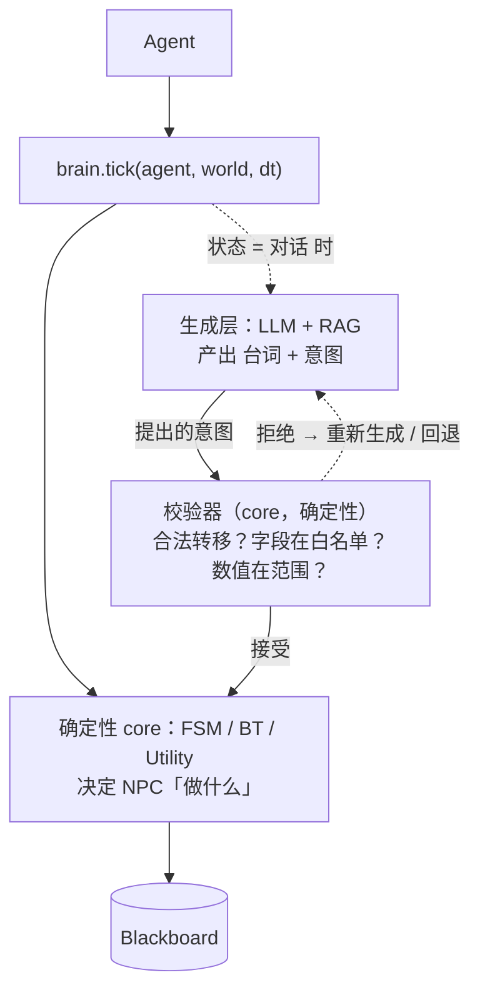

# 架构（Architecture）

## 依赖规则

```
        +-------------------+        implements        +------------------+
        |   demo (pygame)   | -----------------------> |   core (logic)   |
        |  engine-specific  |                          | zero engine dep  |
        +-------------------+                          +------------------+
                                                        |  depends on
                                                        v
                                                  abc.py (interfaces)
```

`core/` 从不 import `demo/`。`demo/` 是唯一知道 pygame 的地方。

## 分层（M1 → M4）

| 层 | 模块 | 引擎无关？ | 状态 |
|-------|--------|------------------|--------|
| 数学 | `vector.py` | 是 | M1 完成 |
| 事件 | `eventbus.py`（Observer） | 是 | M1 完成 |
| 契约 | `abc.py`、`blackboard.py` | 是 | M1 完成 |
| 数据 | `json_defs.py`（Map/Behavior） | 是 | M1 完成 |
| AI | `fsm`、`behavior_tree`、`astar`、`utility`、`steering` | 是（steering 除外） | M2+M4 完成 |
| 适配器 | `demo/pygame_adapter`、`skirmish`、`debug_overlay`、`config_editor` | 否 | M3 完成 |
| 移植 | `cpp/`（FSM/BT/A*/Utility） | 是 | M4 完成 |

## 数据流（skirmish demo）

1. `json_defs` 加载共享的 `map` + `behavior` 定义（C++ 端口读的是同一份文件）。
2. `pygame_adapter` 根据 map 构建 `IAgent`/`IWorld` 实现。
3. 每帧，`world` tick 每个 agent；agent 的 AI（FSM/BT/Utility）读 blackboard + world，写一个速度。
4. `eventbus` 在 agent 与系统之间传递战斗/感知事件。

## 跨语言边界（可移植性的证明）

Python `core/` 和 C++ `cpp/` 端口是「一份契约的两个前端」：同一份中立 JSON map，同一套抽象决策接口（C++ 里是 `AgentView`/`WorldView`，Python 里是 `IAgent`/`IWorld`）。

```mermaid
graph TD
    JSON[(shared map JSON)] --> Py[Python core]
    JSON --> Cpp[C++ port]
    Py -->|find_path / decide / FSM.update| PyOut[normalized result]
    Cpp -->|parity_runner| CppOut[normalized result]
    PyOut -. compared by tests/test_parity.py .-> CppOut
    Cpp -->|static lib gameai_core| UE[(Unreal / C++ engine)]
```

`cpp/src/parity_runner.cpp` 输出一段归一化字符串（路径如 `x,y;…`、被选中的选项名、或最终 FSM 状态）。`tests/test_parity.py` 在 Python 里重算同样的东西并断言字符串一致——把「Python ≡ C++」变成一个**在 CI 里被检查的不变量**，而不是一句空话。Steering 和 event bus 有意只保留在 Python（见 `docs/adr/0002-cpp-thin-port.md`）。

## 混合架构：确定性 core + 生成式 LLM（M5，规划中）

目标：把工具库升级成 **LLM 驱动的 NPC** 框架，合并 `npc_dialogue` 原型（RAG + 基于 DeepSeek 的工具调用）——同时不破坏 core 的零依赖属性。

**分工** —— 两个生成器 + 一个确定性守门人：

| 层 | 决定 | 属性 | 依赖 |
|-------|---------|----------|------------|
| 确定性（`core`） | **NPC「做什么」** —— 状态、合法行为、转移 | 引擎无关、零依赖、可单测、不会幻觉 | 无 |
| 生成式（`integrations/`） | **NPC「说什么」** —— 台词、选项、语气 | 可选、可插拔 | `requests`、`sentence-transformers`、`faiss` |
| 校验器（`core`） | **LLM 提出的意图是否合法 / 越权** | 确定性、可单测 | 无 |

接缝是现成的 `brain` 鸭子类型：`Agent.tick()` 调 `brain.tick(agent, world, dt)`。`LlmBrain` 和 `FsmBrain` / `UtilityBrain` 实现同一接口，两层可互换——**一行 `core` 代码都不用改**。

LLM **从不直接改状态**。它只能**提出一个意图**（比如「好感度 +1」「切换到状态 `熟悉`」）。一个确定性的**校验器**在 `core` 里，落地前先检查三条规则：

1. 这个转移在 FSM 表里合法吗？
2. 目标字段在 LLM 的「可写白名单」里吗？
3. 数值在合法范围内吗？



**从构造上防幻觉**：LLM 只能在确定性层划定的合法空间里生成，它提出的任何变更都必须通过确定性校验器。校验器是 **core 代码，不是第二个 LLM**——用一个 LLM 去校验另一个 LLM，等于让「越权」变成模型自己说了算，那就失去意义了。当 LLM 不可用（没 key / 离线），确定性层照常运行，对话降级成模板文本——游戏绝不会因为模型挂了而崩。
